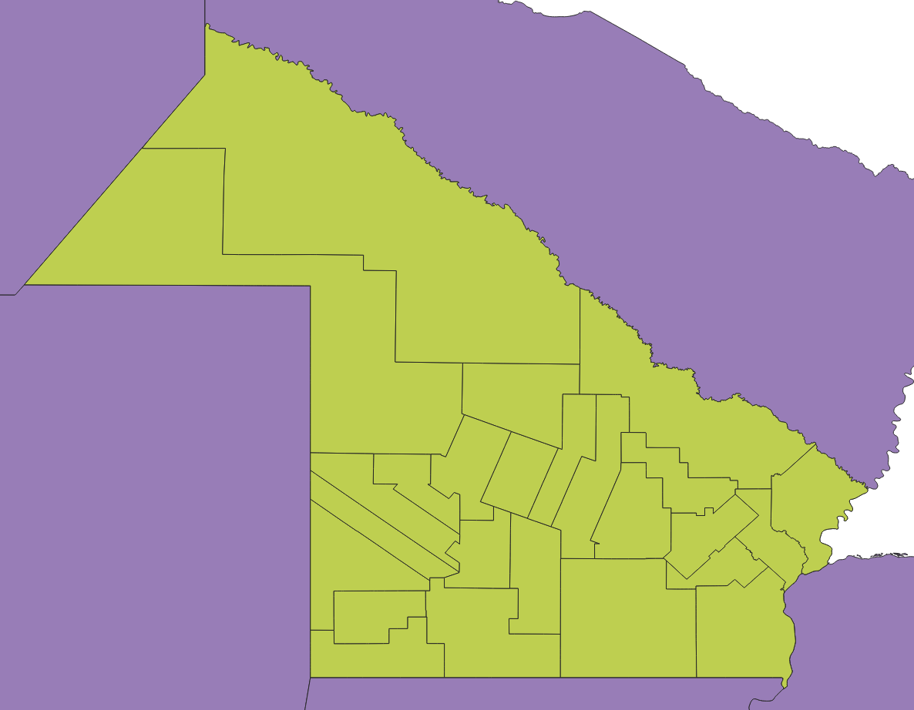

La API te permite descargar geometrías en dos formatos:

- [ESRI Shapefile](https://es.wikipedia.org/wiki/Shapefile), con `formato=shp`. La respuesta es un archivo ZIP con los cuatro archivos estándar: `.shp`, `.shx`, `.dbf` y `.prj`.
- [GeoPackage](https://www.geopackage.org/), con `formato=gpkg` (nuevo en la v2). La respuesta es un único archivo `.gpkg`.

Los dos formatos están disponibles en la versión `GET` de todos los recursos, salvo `/ubicacion`. Podés abrir los archivos con programas como [QGIS](https://qgis.org/). El sistema de coordenadas es WGS84 (EPSG 4326).

:::note
Con `formato=geojson` la API devuelve **puntos** (el centroide de cada entidad), no polígonos. Para obtener polígonos o líneas, usá `shp` o `gpkg`.
:::

Por ejemplo, para bajar todas las calles del gobierno local Alta Gracia (ID 141372):

`GET` [`https://apis.datos.gob.ar/georef/api/v2.1/calles?interseccion=gobierno_local:141372&formato=shp&max=1000`](https://apis.datos.gob.ar/georef/api/v2.1/calles?interseccion=gobierno_local:141372&formato=shp&max=1000)

Descarga `calles.zip`, con `calles.shp`, `calles.shx`, `calles.dbf` y `calles.prj`.

Para bajar todos los departamentos de Chaco:

`GET` [`https://apis.datos.gob.ar/georef/api/v2.1/departamentos?provincia=chaco&formato=shp&max=1000`](https://apis.datos.gob.ar/georef/api/v2.1/departamentos?provincia=chaco&formato=shp&max=1000)

La misma consulta en GeoPackage:

`GET` [`https://apis.datos.gob.ar/georef/api/v2.1/departamentos?provincia=chaco&formato=gpkg&max=1000`](https://apis.datos.gob.ar/georef/api/v2.1/departamentos?provincia=chaco&formato=gpkg&max=1000)

Descarga `departamentos.gpkg`.

Si necesitás todas las entidades de un tipo, usá la [descarga de la base completa](/georef-ar-api/download/).
