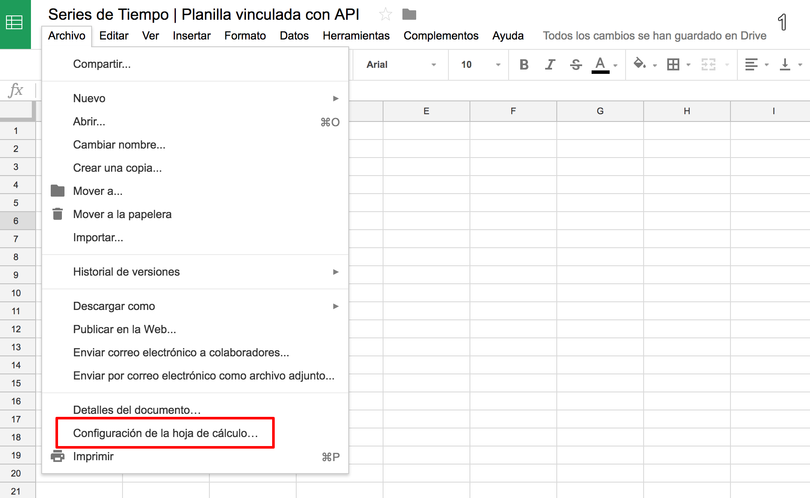
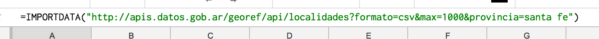
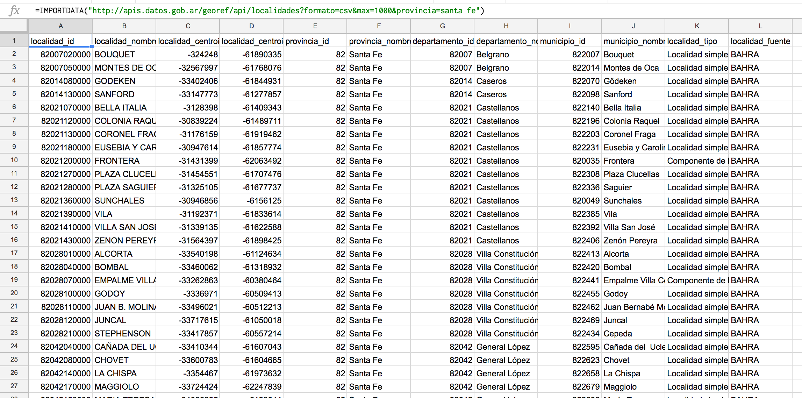
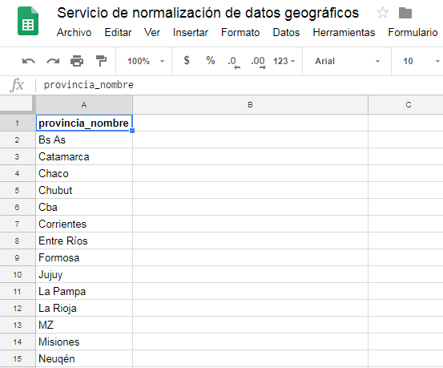
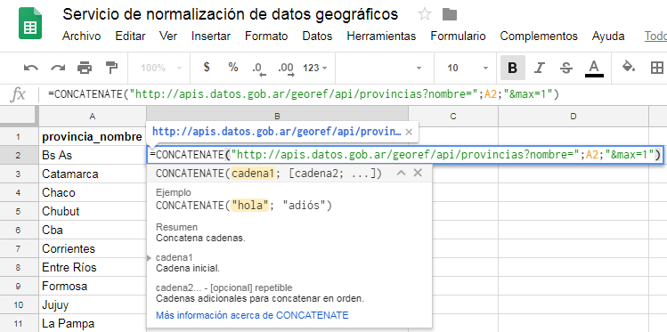
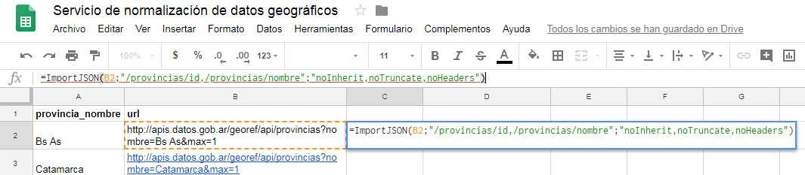
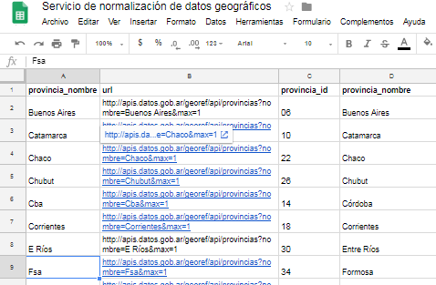

## Google Drive

### 1. Modificar la configuración regional

La API genera archivos CSV con “.” como separador decimal. Para que Google Sheets lea bien el archivo, elegí “Estados Unidos” u otra región compatible en la configuración regional (esto solo afecta la lectura de coordenadas).

### 2. Importar listados de unidades territoriales

Usá la función `IMPORTDATA()` de Google Sheets con la URL de las entidades que querés importar. Por ejemplo, “localidades de la provincia de Santa Fe”:

[`https://apis.datos.gob.ar/georef/api/v2.1/localidades?formato=csv&max=1000&provincia=santa%20fe`](https://apis.datos.gob.ar/georef/api/v2.1/localidades?formato=csv&max=1000&provincia=santa%20fe)

:::note
Las capturas son de la v1.0. En la v2.1 el CSV de localidades trae las columnas `localidad_id`, `localidad_nombre`, `localidad_centroide_lat`, `localidad_centroide_lon`, `provincia_id`, `provincia_nombre`, `departamento_id`, `departamento_nombre`, `gobierno_local_id`, `gobierno_local_nombre`, `localidad_censal_id`, `localidad_censal_nombre` y `localidad_categoria`.
:::

y obtenés:

### 3. Normalizar un listado de unidades territoriales

Si tenés un listado de provincias para normalizar, como este:

Podés armar una URL por fila para normalizar cada nombre y traer algunos atributos, por ejemplo el ID y el nombre normalizado.

Primero generá la URL de cada provincia (con `/v2.1/` en la ruta):

Después importá una función nueva en la hoja de cálculo. Desde el menú:

1. Extensiones → Apps Script.
2. Borrá todo lo que hay en el editor y pegá este [script](https://raw.githubusercontent.com/bradjasper/ImportJSON/master/ImportJSON.gs) de [Bradjasper](https://github.com/bradjasper).
3. Renombrá el script como `ImportJSON.gs` y guardá.
4. Ya podés usar la función `=ImportJSON()` en una celda.

`=ImportJSON(B2;"/provincias/id,/provincias/nombre";"noInherit,noTruncate,noHeaders")`

y obtenés:

